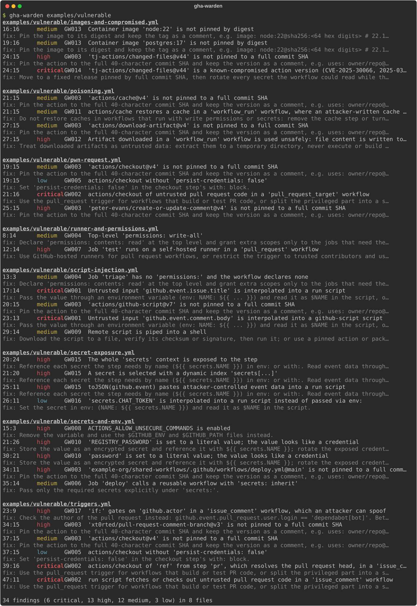

# gha-warden

Static security auditor for GitHub Actions workflows: finds injection and supply-chain risks before they ship.

[](https://github.com/petrhromadka/gha-warden/actions/workflows/ci.yml)
[](LICENSE)
[](https://www.python.org/downloads/)

gha-warden reads your workflow files and reports seventeen classes of problems (script injection, pwn requests, unpinned actions, over-broad permissions, and more) with a file, line, severity and a concrete fix. It is pure static analysis: no network access, no tokens, nothing leaves your machine. Output is human-readable text, JSON, SARIF for GitHub code scanning, workflow annotations, or a Markdown job summary.



## Why

CI workflows run with write tokens and secrets, yet they are often reviewed less carefully than application code. Real incidents come from a small set of recurring patterns. The March 2025 compromise of the widely used `tj-actions/changed-files` action showed what happens when workflows reference third-party actions by a mutable tag instead of a commit SHA. "Pwn requests" abuse `pull_request_target` workflows that check out and run code from a fork. Script injection lets an issue title, branch name or comment body become shell commands when it is expanded with `${{ }}` inside `run:`. gha-warden checks for these patterns, and a few related ones, on every push.

## Quick start

Install with [uv](https://docs.astral.sh/uv/) or pipx:

```sh
uv tool install git+https://github.com/petrhromadka/gha-warden
# or
pipx install git+https://github.com/petrhromadka/gha-warden
```

Scan the workflows of the repository in the current directory (the default path is `.github/workflows`):

```sh
gha-warden
```

Scan specific files or directories, including composite actions:

```sh
gha-warden .github/workflows action.yml --min-severity medium
```

Try it on the bundled demos:

```sh
gha-warden examples/vulnerable   # reports findings, exit code 1
gha-warden examples/safe         # clean, exit code 0
```

### Usage

```
gha-warden [PATHS...] [--format text|json|sarif|github|markdown]
           [--min-severity low|medium|high|critical] [--ignore RULE_ID[,RULE_ID...]]
           [--config PATH] [--output FILE] [--no-color] [--version]
```

| Option | Meaning |
|--------|---------|
| `PATHS` | Files or directories. Directories are scanned recursively for `*.yml` and `*.yaml` (`.git`, `.venv` and `node_modules` are skipped). Default: `.github/workflows`. |
| `--format` | `text` (default), `json`, `sarif`, `github`, or `markdown`. |
| `--min-severity` | Hide findings below this severity. |
| `--ignore RULE_ID` | Skip a rule entirely. Repeat the option or separate IDs with commas (`--ignore GW005,GW003`); IDs are case-insensitive and an unknown ID is a usage error. |
| `--config PATH` | Read settings from this TOML file instead of `.gha-warden.toml`. |
| `--output FILE` | Write the report to a file instead of stdout. |
| `--no-color` | Disable colors. Colors are only used when stdout is a terminal, and never with `--output`; a non-empty `NO_COLOR` environment variable disables them too. |
| `--version` | Print the version and exit. |

## Example output

```text
$ gha-warden --no-color examples/vulnerable/script-injection.yml
examples/vulnerable/script-injection.yml
  13:3    medium   GW004  Job 'triage' has no 'permissions:' and the workflow declares none
      fix: Declare 'permissions: contents: read' at the top level and grant extra scopes only to the jobs that need them.
  17:14   critical GW001  Untrusted input 'github.event.issue.title' is interpolated into a run script
      fix: Pass the value through an environment variable (env: NAME: ${{ ... }}) and read it as $NAME in the script, or as process.env.NAME in github-script.
  20:15   medium   GW003  'actions/github-script@v7' is not pinned to a full commit SHA
      fix: Pin the action to the full 40-character commit SHA and keep the version as a comment, e.g. uses: owner/repo@<sha> # v4.
  23:13   critical GW001  Untrusted input 'github.event.comment.body' is interpolated into a github-script script
      fix: Pass the value through an environment variable (env: NAME: ${{ ... }}) and read it as $NAME in the script, or as process.env.NAME in github-script.
  29:14   medium   GW009  Remote script is piped into a shell
      fix: Download the script to a file, verify its checksum or signature, then run it; or use a pinned action or package instead.

5 findings (2 critical, 3 medium) in 1 file
```

## Rules

| ID | Severity | What it detects | Why it matters | Fix |
|----|----------|-----------------|----------------|-----|
| GW001 | critical | Untrusted `${{ }}` context (issue and PR titles and bodies, comment and review bodies, `head_ref`, commit messages and authors, `workflow_run.head_*`, and similar) used in `run:` or in the `script:` of `actions/github-script` | The value is pasted into the script before it runs, so attacker-controlled text becomes code in a job that has your token and secrets | Pass the value through `env:` and use the shell variable (`"$TITLE"`) |
| GW002 | critical | `pull_request_target`, `workflow_run` or `issue_comment` workflow that checks out or fetches PR code: `actions/checkout` with a `ref:` from `pull_request.head.*`, `head_ref`, `workflow_run.head_*`, `refs/pull/...` or a step output that resolves the PR head, or a `run:` step with `gh pr checkout`, `git fetch origin pull/...` or `git checkout` of the PR head | The workflow runs with a write token and secrets but executes code from a fork | Use `pull_request` for untrusted code, or build unprivileged and hand artifacts to a separate privileged workflow |
| GW003 | high / medium | Action not pinned to a full 40-character commit SHA. `actions/*` and `github/*` are medium, every other owner is high. Local `./` actions and `docker://` references with a digest are skipped | Tags and branches can be moved; a compromised tag changes what runs in your pipeline | Pin to the commit SHA and keep the version in a trailing comment (Dependabot can update it) |
| GW004 | medium | `permissions: write-all`, or no top-level `permissions:` and a job without its own | The default token can be broader than the job needs | Set `permissions: contents: read` at the top and grant more per job |
| GW005 | low | `actions/checkout` without `persist-credentials: false` | The token stays in `.git/config`, readable by later steps and possibly uploaded with artifacts | Add `persist-credentials: false` |
| GW006 | medium | Reusable workflow call with `secrets: inherit` | Hands every secret to the called workflow, including ones it does not need | Pass only the required secrets explicitly |
| GW007 | high | Self-hosted runner used by a job in a workflow triggered by `pull_request` or `pull_request_target` | Untrusted PR code can run on, and persist on, your own infrastructure | Use GitHub-hosted runners for PR workflows, or ephemeral isolated runners |
| GW008 | high | `ACTIONS_ALLOW_UNSECURE_COMMANDS` set in `env:` at workflow, job or step level | Re-enables the deprecated `set-env` and `add-path` workflow commands, which untrusted log output can abuse | Remove it and use `$GITHUB_ENV` and `$GITHUB_PATH` |
| GW009 | medium | Remote script piped to a shell in `run:` (`curl ... \| bash`, `wget -O- ... \| sh`, and similar) | Executes whatever the server returns, unverified | Download, verify a checksum or signature, then run |
| GW010 | high | Credential-looking literal in `env:` or `with:` (keys named like `token`, `password`, `secret`, `api_key` with a non-expression value) | Secrets committed to the repository are exposed to everyone with read access and stay in git history | Store it as a repository secret and reference `${{ secrets.NAME }}` |
| GW011 | medium | `pull_request_target`, `workflow_run` or `issue_comment` workflow that restores a cache (`actions/cache`, `actions/cache/restore`, or `setup-node`, `setup-python`, `setup-go`, `setup-java` and `setup-uv` with caching on) | Untrusted workflows can write cache entries that this privileged job then restores and runs | Do not restore caches in workflows with write permissions or secrets |
| GW012 | high | `workflow_run` or `pull_request_target` workflow that downloads artifacts from another run (`download-artifact` with `run-id`, `dawidd6/action-download-artifact`, `gh run download`) and then writes file content to `$GITHUB_ENV`, `$GITHUB_OUTPUT` or `$GITHUB_PATH`, runs a downloaded file, or builds in the download directory | Artifacts from pull request runs are attacker-controlled, so using them unchecked gives code execution with the privileged token | Treat artifacts as data: unpack to a temp dir, validate values, never execute or build them |
| GW013 | medium | Container image not pinned by digest: `container:` (string or `image:`) and `services.*.image` without `@sha256:<64 hex>`. Image names that are `${{ }}` expressions are skipped | Tags in a registry can be re-pushed; the image runs next to your steps and secrets | Pin the image to its digest and keep the tag in a trailing comment |
| GW014 | critical | `uses:` reference matching a publicly documented action compromise (offline list: `tj-actions/changed-files`, `reviewdog/action-setup`, `aquasecurity/trivy-action`, `aquasecurity/setup-trivy`, `xygeni/xygeni-action`) | The version ran attacker code with your secrets | Move to a fixed release pinned by SHA and rotate exposed secrets |
| GW015 | high | The whole `secrets` context passed on (`toJSON(secrets)`, `${{ secrets }}`, or `secrets[...]` with a computed name) anywhere in the workflow; `toJSON(github)` or `toJSON(github.event)` in `run:` | One step gets every secret, which defeats least privilege; the event dump pastes attacker-controlled text into the shell | Reference each needed secret by name in `env:` or `with:`; pass event fields through `env:` |
| GW016 | low | `${{ secrets.NAME }}` or `${{ github.token }}` used directly inside a `run:` script | The value is written into the generated script, can appear in process listings and traces, and breaks on special characters | Set it in `env:` and use `$NAME` in the script |
| GW017 | high | `pull_request_target`, `workflow_run` or `issue_comment` workflow with an `if:` on a job or step that trusts `github.actor == '...[bot]'` (for example `dependabot[bot]`) or `github.triggering_actor` | The actor is whoever acted last on the PR, not its author; an attacker can make Dependabot the actor on a PR they control by asking it to rebase | Check `github.event.pull_request.user.login` (the PR author) or use `dependabot/fetch-metadata` |

GW002, GW011, GW012 and GW017 are not reported for a `workflow_run` workflow when every upstream workflow it names is scanned in the same run and none of them can be started by untrusted input; see [GW002](docs/rules/GW002.md#cross-workflow-analysis).

## Output formats

- `text`: grouped by file, colored severity, summary line.
- `json`: list of findings plus summary counts, for scripting.
- `sarif`: SARIF 2.1.0 with the rule metadata populated, so GitHub code scanning shows titles, help text and a `security-severity` (low 3.0, medium 5.0, high 7.5, critical 9.5).
- `github`: one [workflow command](https://docs.github.com/en/actions/reference/workflows-and-actions/workflow-commands) per finding, which GitHub shows as an annotation on the run and the pull request diff. Critical and high are errors, medium is a warning, low is a notice.
- `markdown`: a severity summary table and a findings table (severity, rule, `file:line`, message), for `$GITHUB_STEP_SUMMARY` or a pull request comment.

```sh
gha-warden --format github                                  # annotations on stdout
gha-warden --format markdown >> "$GITHUB_STEP_SUMMARY"      # job summary
```

## Config file

gha-warden reads `.gha-warden.toml` from the current directory if it exists, or the file given with `--config PATH`:

```toml
ignore = ["GW005"]        # rules to skip
min-severity = "medium"   # low, medium, high or critical
exclude = ["examples/*", "*/legacy/*.yml"]   # paths to skip
```

`exclude` patterns are shell-style globs matched against the path as shown in the report (relative to the repository root, else the current directory, with `/` separators); `*` also matches across directories. Precedence: command-line flags beat the config file, which beats the defaults. `--ignore` replaces the config's `ignore` list rather than adding to it, and `--min-severity` replaces `min-severity`. An unreadable or invalid config (bad TOML, unknown key, unknown rule ID, wrong type) exits with code 2.

### Upload SARIF to GitHub code scanning

```yaml
name: gha-warden

on:
  push:
    branches: [main]
  pull_request:

permissions:
  contents: read

jobs:
  scan:
    runs-on: ubuntu-latest
    permissions:
      contents: read
      security-events: write
    steps:
      - uses: actions/checkout@3d3c42e5aac5ba805825da76410c181273ba90b1 # v7.0.1
        with:
          persist-credentials: false
      - uses: astral-sh/setup-uv@68559e99cc807c1eb7e9238fd43a15bba460eec2 # v10.3.3
      - run: uvx --from git+https://github.com/petrhromadka/gha-warden@ba49757f31e8ac67695c414b2cca37cbef1983a2 gha-warden --format sarif --output gha-warden.sarif || [ $? -eq 1 ]
      - uses: github/codeql-action/upload-sarif@33d7b85da1a04171e211befe2c739303b9a4c066 # v4.39.3
        with:
          sarif_file: gha-warden.sarif
          category: gha-warden
```

The `|| [ $? -eq 1 ]` keeps the step green when findings exist (exit code 1) so the upload still runs, while usage and parse errors (exit code 2) still fail it. The SHAs above were current when v0.1.2 was released; let Dependabot keep them up to date.

## Use as a GitHub Action

The repository ships a composite action. Pin it to a commit SHA, like any other third-party action:

```yaml
name: gha-warden

on:
  push:
    branches: [main]
  pull_request:

permissions:
  contents: read

jobs:
  audit:
    runs-on: ubuntu-latest
    permissions:
      contents: read
      security-events: write # needed to upload SARIF
    steps:
      - uses: actions/checkout@3d3c42e5aac5ba805825da76410c181273ba90b1 # v7.0.1
        with:
          persist-credentials: false
      - uses: petrhromadka/gha-warden@ba49757f31e8ac67695c414b2cca37cbef1983a2 # v0.1.2
        with:
          min-severity: medium
```

| Input | Default | Meaning |
|-------|---------|---------|
| `paths` | `.github/workflows` | Space-separated files or directories to scan |
| `min-severity` | empty | Lowest severity to report; empty uses `min-severity` from `.gha-warden.toml`, else `low` |
| `format` | `sarif` | `text`, `json`, `sarif`, `github` or `markdown` |
| `upload-sarif` | `true` | Upload results to code scanning (needs `security-events: write`) |
| `annotations` | `true` | Emit one workflow annotation per finding |
| `fail-on-findings` | `true` | Fail the job when findings at or above `min-severity` exist |

The action also appends the Markdown report to the job summary. It runs in the workspace, so a `.gha-warden.toml` at the repository root is picked up. Inputs are passed to the scanner through environment variables, never interpolated into the shell script.

## Suppressing a finding

Add a YAML comment on the line of the finding:

```yaml
      - run: curl -sSL https://example.com/install.sh | bash # gha-warden: ignore[GW009]
```

`# gha-warden: ignore[GW001,GW003]` suppresses several rules; `# gha-warden: ignore` with no list suppresses all rules on that line. Use `--ignore GW005` to disable a rule for the whole run. Please leave a reason next to every suppression.

## Exit codes

| Code | Meaning |
|------|---------|
| 0 | No findings at or above `--min-severity` |
| 1 | One or more findings |
| 2 | Usage error, or a path that does not exist or a file that cannot be read or parsed (the remaining files are still scanned and reported) |

## Documentation

- [Rule reference](docs/rules/README.md): one page per rule with a vulnerable and a fixed example and references.
- [Real-world scan](docs/real-world-scan.md): results and false-positive triage on 1068 workflow files from 42 popular repositories.
- [Regression corpus](corpus/README.md): minimal reproductions of 13 publicly documented incidents and advisories, checked in CI.
- [Fuzzing](fuzz/README.md): the Atheris coverage-guided fuzz target that CI runs on every pull request and weekly.
- [Threat model](docs/threat-model.md) and [supply-chain notes](docs/supply-chain.md): what gha-warden covers, and how its own releases are built and attested.

## Development

```sh
uv sync
uv run pytest
uv run ruff check .
uv run ruff format --check .
uv run ty check
```

CI runs the same checks on Linux and Windows, then scans this repository's own workflows with gha-warden; that job must stay clean. See [CONTRIBUTING.md](CONTRIBUTING.md) for how to add a rule and [SECURITY.md](SECURITY.md) for reporting vulnerabilities.

## Related work

gha-warden is inspired by [zizmor](https://github.com/zizmorcore/zizmor), [poutine](https://github.com/boostsecurityio/poutine) and the [GitHub Security Lab research on preventing pwn requests](https://securitylab.github.com/resources/github-actions-preventing-pwn-requests/). If you need a broader or more mature audit, use those; gha-warden is a small tool with a single runtime dependency (PyYAML) and a focused rule set.

## License

[MIT](LICENSE) © 2026 Petr Hromádka
